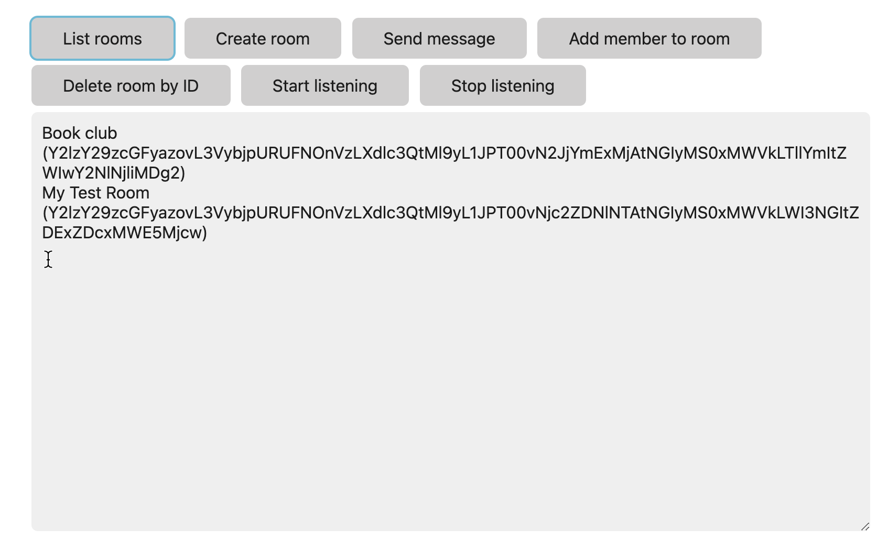
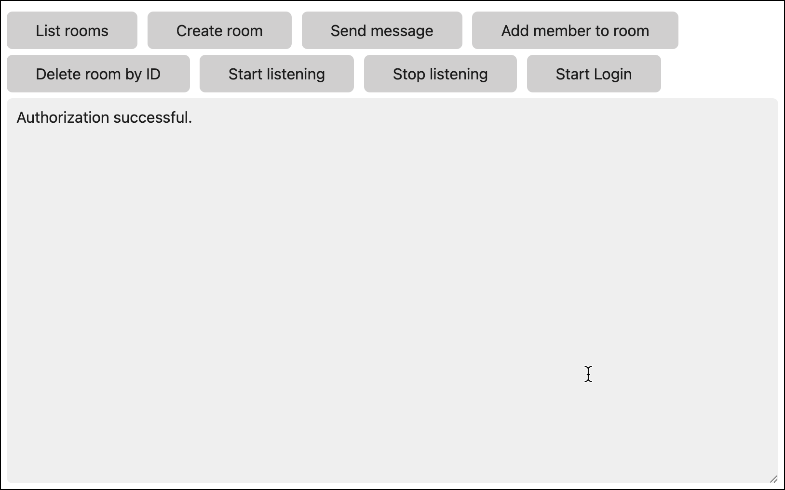

# Browser SDK Messaging Sample App

A comprehensive sample application demonstrating how to use the Webex Browser SDK for messaging functionality. This interactive web application showcases essential Webex messaging features in a simple, easy-to-understand format.



## 🎯 Features

This sample shows how to use the Webex Browser SDK to do the following:

* **List rooms (spaces)** you belong to
* **Create and delete rooms** programmatically
* **Send messages** to a room
* **Add members** to a room
* **Listen for newly created or deleted messages** in a room
* **Real-time event handling** with WebSocket connections

## 📚 Tutorial

This app accompanies a [tutorial](https://developer.webex.com/docs/browser-sdk-messaging-tutorial) on the Webex Developer Portal that you can follow along with using the [starter files](./starter), or run the [completed project](./completed).

## 🚀 Quick Start

### Prerequisites

- Modern web browser (Chrome, Firefox, Safari, Edge)
- Webex Teams account
- Personal access token from the Webex Developer Portal

### Getting Your Personal Access Token

1. Go to the [Webex Developer Portal](https://developer.webex.com/)
2. Sign in with your Webex account
3. Navigate to **Getting Started** > **Your Personal Access Token**
4. Copy the generated token

> **Production Note**: In a production environment you will want to create a [Webex Integration](https://developer.webex.com/docs/integrations) (OAuth client) that will obtain an API access token for the authenticating Webex user.

### Setup Instructions

1. **Clone or download** this repository
2. **Choose your path**:
   - **Learning path**: Start with the [starter files](./starter) and follow the tutorial
   - **Ready-to-use**: Use the [completed project](./completed)

3. **Configure your token** in the appropriate `index.js` file:

```javascript
const webex = (window.webex = window.Webex.init({
    credentials: {
        access_token: "<YOUR-PERSONAL-ACCESS_TOKEN>"
    }
}));
```

4. **Open `index.html`** in your browser
5. **Verify setup**: You should see an "Authentication successful" message



## 📁 Project Structure

```
browser-sdk-demo/
├── completed/          # Full working implementation
│   ├── index.html      # Complete HTML interface
│   └── index.js        # Complete JavaScript functionality
├── starter/            # Starting point for tutorial
│   ├── index.html      # Basic HTML structure
│   └── index.js        # Minimal JavaScript setup
├── app.png            # Application screenshot
├── authorized.png     # Success state screenshot
└── README.md          # This file
```

## 🔧 Functionality Overview

### Core Features

| Feature | Description | Implementation |
|---------|-------------|----------------|
| **List Rooms** | Retrieve up to 10 rooms you belong to | `webex.rooms.list()` |
| **Create Room** | Create new rooms with custom names | `webex.rooms.create()` |
| **Send Message** | Send text messages to rooms | `webex.messages.create()` |
| **Add Member** | Add users to rooms by email | `webex.memberships.create()` |
| **Delete Room** | Remove rooms by ID | `webex.rooms.remove()` |
| **Start Listening** | Listen for real-time message events | `webex.messages.listen()` |
| **Stop Listening** | Stop listening for events | `webex.messages.stopListening()` |

### Event Handling

The application demonstrates real-time event handling:

```javascript
// Listen for new messages
webex.messages.on("created", (event) => {
    console.log("New message:", event);
});

// Listen for deleted messages
webex.messages.on("deleted", (event) => {
    console.log("Message deleted:", event);
});
```

## 🎨 User Interface

The application uses a clean, minimal design with:

- **Water.css** for styling (loaded from CDN)
- **Interactive buttons** for each main function
- **Text area** for logging output and feedback
- **Responsive design** that works on mobile and desktop

### Button Functions

- **List rooms**: Display all rooms you belong to
- **Create room**: Prompt for room name and create new room
- **Send message**: Send a message to the most recently created room
- **Add member**: Add a user to the current room by email
- **Delete room**: Remove a room by ID
- **Start/Stop listening**: Toggle real-time event listening

## 🔐 Authentication

The sample uses personal access tokens for simplicity. The authentication flow:

1. Initialize Webex SDK with access token
2. SDK validates token with Webex servers
3. `ready` event fires when authentication succeeds
4. Application displays "Authorization successful" message

## 📡 API Integration

### Webex SDK Methods Used

- `webex.rooms.list()` - List user's rooms
- `webex.rooms.create()` - Create new room
- `webex.rooms.remove()` - Delete room
- `webex.messages.create()` - Send message
- `webex.messages.listen()` - Start event listening
- `webex.messages.stopListening()` - Stop event listening
- `webex.memberships.create()` - Add room member

### Error Handling

The application includes comprehensive error handling:

```javascript
webex.rooms.list()
    .then(function (rooms) {
        // Handle success
    })
    .catch(function (error) {
        // Handle and log errors
        log(error);
    });
```

## 🌐 Browser Compatibility

- **Chrome**: ✅ Full support
- **Firefox**: ✅ Full support
- **Safari**: ✅ Full support
- **Edge**: ✅ Full support
- **Internet Explorer**: ❌ Not supported

## 🔧 Development

### Local Development

1. Serve files from a local web server (required for SDK to work properly)
2. Use tools like:
   - `python -m http.server` (Python)
   - `npx http-server` (Node.js)
   - VS Code Live Server extension

### Debugging

- Open browser developer tools
- Check console for SDK initialization messages
- Monitor network tab for API calls
- Use the text area output for application-level logging

## 📝 Code Examples

### Basic Room Creation

```javascript
function createRoom() {
    const roomName = prompt("Enter room name", "My Test Room");
    
    webex.rooms.create({ title: roomName })
        .then(function (room) {
            console.log(`Created room: ${room.title}`);
            newRoomId = room.id; // Store for later use
        })
        .catch(function (error) {
            console.error("Error creating room:", error);
        });
}
```

### Message Sending

```javascript
function sendMessage() {
    const msgText = prompt("Enter message text", "Hello from Webex SDK!");
    
    webex.messages.create({
        text: msgText,
        roomId: newRoomId
    })
    .then(function (message) {
        console.log("Message sent successfully");
    })
    .catch(function (error) {
        console.error("Error sending message:", error);
    });
}
```

## 🚀 Production Considerations

For production applications, consider:

1. **OAuth Integration**: Replace personal access tokens with proper OAuth flow
2. **Error Handling**: Implement robust error handling and user feedback
3. **Rate Limiting**: Handle API rate limits gracefully
4. **Security**: Never expose tokens in client-side code
5. **Performance**: Implement proper loading states and user feedback

## 📚 Learning Path

1. **Start with tutorial**: Follow the [browser SDK messaging tutorial](https://developer.webex.com/docs/browser-sdk-messaging-tutorial)
2. **Explore starter files**: Begin with minimal setup in `/starter`
3. **Study completed example**: Review full implementation in `/completed`
4. **Experiment**: Modify and extend the functionality
5. **Build your own**: Create a custom application using learned concepts

## 🔗 Related Resources

- [Webex Browser SDK Documentation](https://developer.webex.com/docs/browser-sdk)
- [Webex API Reference](https://developer.webex.com/docs/api/v1/)
- [Webex Developer Portal](https://developer.webex.com/)
- [Browser SDK Tutorial](https://developer.webex.com/docs/browser-sdk-messaging-tutorial)
- [Webex Integration Guide](https://developer.webex.com/docs/integrations)

## 🤝 Contributing

1. Fork the repository
2. Create a feature branch
3. Make your changes
4. Test thoroughly
5. Submit a pull request

## 📄 License

This project is licensed under the terms specified in the [LICENSE](LICENSE) file.

## 🆘 Support

- Create an issue in this repository
- Visit [Webex Developer Support](https://developer.webex.com/support)
- Join the [Webex Developer Community](https://developer.webex.com/community)

---

**Repository**: https://github.com/WebexSamples/browser-sdk-demo
